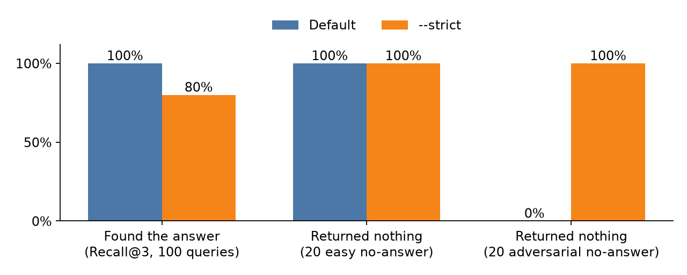

# Boring Agent Memory

[](https://github.com/hskl18/boring-agent-memory/actions/workflows/tests.yml)

Local BM25 recall over the files your agent already trusts, with line citations and a check that each source still matches what was indexed.

**Status: alpha.** The CLI, Python API, and index schema may still change before 1.0.

Most agent memory failures are not failures of semantic search.
They are failures of trust: stale state, missing provenance, private data captured by default, and memory overriding the source of truth.

Boring Agent Memory indexes the docs, skills, runbooks, bug logs, and ADRs you choose with SQLite FTS5.
It returns source paths and snippets, and your agent reads the cited file before it acts.
It needs no hosted service, embedding API, vector database, model download, or account.



*Benchmark v1, synthetic fixtures: strict mode gives up recall on vague queries in exchange for returning nothing when no file answers. [Numbers and method](https://github.com/hskl18/boring-agent-memory#evidence).*

## Install

```bash
python -m pip install boring-agent-memory
```

It needs Python 3.11 or newer.

## Try It

```bash
mkdir notes
printf '# Deploys\n\nRoll back database migrations within 15 minutes.\n' > notes/deploys.md

bam build --include notes
bam query "roll back migrations"
```

```text
deploys.md  score=-3e-06
  /path/to/notes/deploys.md
  # Deploys

[Roll] [back] database [migrations] within 15 minutes.
```

Now change the file and check whether the index still matches it:

```bash
printf '# Deploys\n\nRoll back within 30 minutes.\n' > notes/deploys.md

bam inspect notes/deploys.md
bam update --include notes
```

`bam inspect` reports `content_hash_match: False` until `bam update` picks up the edit.

## Use Your Own Files

Point a config at the files you trust and save it as `memory.yaml`:

```yaml
index_path: ~/.bam/memory.db
source_type: canonical_file
workspace: ~/project/app

include:
  - ~/agent/skills
  - ~/project/*/docs

exclude:
  - "**/secrets/**"
```

```bash
bam build --config memory.yaml --json
bam update --config memory.yaml --dry-run --json
bam update --config memory.yaml --json

bam --db ~/.bam/memory.db query "rollback policy" --limit 5 --json
```

A database that does not exist is an error, so a mistyped path cannot look like an empty memory.

## Use It From An Agent

```python
from boring_agent_memory import memory_query

results = memory_query(
    "rollback policy for database migrations",
    limit=5,
    source_type="canonical_file",
    db_path="~/.bam/memory.db",
)

for result in results:
    print(result.citation)
    print(result.snippet)
```

Other processes can use `bam serve --stdio`, which speaks JSON lines. See the [CLI reference](https://github.com/hskl18/boring-agent-memory/blob/main/docs/cli.md).

Agent instructions to copy are in [docs/agent-prompt.md](https://github.com/hskl18/boring-agent-memory/blob/main/docs/agent-prompt.md), with setups for [Claude Code](https://github.com/hskl18/boring-agent-memory/blob/main/examples/claude_code.md), [Codex](https://github.com/hskl18/boring-agent-memory/blob/main/examples/codex.md), and [Hermes](https://github.com/hskl18/boring-agent-memory/blob/main/docs/hermes-integration.md).

## Architecture

<picture>
  <source media="(prefers-color-scheme: dark)" srcset="https://raw.githubusercontent.com/hskl18/boring-agent-memory/main/docs/architecture-dark.svg">
  
</picture>

The index is a recall cache over files you already trust, not the source of truth: every result names a file and line span, and the agent reads those lines before it acts.
The [architecture notes](https://github.com/hskl18/boring-agent-memory/blob/main/docs/architecture.md) cover the schema, chunk IDs, transactional updates, and the query fallbacks.

## Evidence

On Benchmark v2's 12 synthetic queries, chunked BM25 finds the right lines first every time, while whole-document BM25 finds the right file 91% of the time and never the right lines.
These are deterministic fixture results, not production traffic or a broad semantic-memory claim.
See [Benchmark v2](https://github.com/hskl18/boring-agent-memory/blob/main/docs/benchmark-v2.md) and [why BM25 comes first](https://github.com/hskl18/boring-agent-memory/blob/main/docs/canonical-first-memory.md#why-bm25-first).

Knowing when to return nothing matters as much as recall.
On Benchmark v1, 20 adversarial no-answer queries pair one system's name with another system's setting, such as "current cobalt idle timeout": every word is in the corpus, but no file answers it.

| Query path | Recall@3 on 100 answerable queries | Vague queries | Easy no-answer returned nothing | Adversarial no-answer returned nothing |
| --- | ---: | ---: | ---: | ---: |
| Default | 1.00 | 1.00 | 20 of 20 | 0 of 20 |
| `--strict` | 0.80 | 0.00 | 20 of 20 | 20 of 20 |

The default falls back to an any-term match, so it answers every vague query and every adversarial one; those results carry `"strategy": "or"`, which marks a partial match.
`--strict` skips the any-term and substring fallbacks, so it refuses both the vague and the adversarial queries, at the cost of vague recall, and suits callers that would rather get nothing than a partial match.
Neither mode makes a result authoritative, so the agent still reads the cited lines.
See [Benchmark v1](https://github.com/hskl18/boring-agent-memory/blob/main/docs/benchmark-v1.md#adversarial-abstention) for the method and the [CLI reference](https://github.com/hskl18/boring-agent-memory/blob/main/docs/cli.md) for what `--strict` matches.

## What It Is Not

- Not a chatbot brain or an auto-capture memory system. It indexes only paths you name.
- Not a replacement for semantic search over vague queries.
- Not an authority over current files. Canonical files come first, BM25 recall second, model memory last.
- Not a hosted service or a vector database.

## Privacy

Secret-bearing paths are skipped and common secret patterns are redacted before indexing, but these are guardrails, not a formal secret scanner.
Read the [privacy model](https://github.com/hskl18/boring-agent-memory/blob/main/docs/privacy-model.md) before choosing what to index.

## Documentation

- [CLI reference](https://github.com/hskl18/boring-agent-memory/blob/main/docs/cli.md)
- [Configuration](https://github.com/hskl18/boring-agent-memory/blob/main/docs/configuration.md)
- [Python API](https://github.com/hskl18/boring-agent-memory/blob/main/docs/python-api.md)
- [Architecture](https://github.com/hskl18/boring-agent-memory/blob/main/docs/architecture.md)
- [Comparison with other memory tools](https://github.com/hskl18/boring-agent-memory/blob/main/docs/comparison.md)
- [Status and known limits](https://github.com/hskl18/boring-agent-memory/blob/main/docs/status-and-gaps.md)
- [Roadmap](https://github.com/hskl18/boring-agent-memory/blob/main/docs/roadmap.md)

## Contributing

See [CONTRIBUTING.md](https://github.com/hskl18/boring-agent-memory/blob/main/CONTRIBUTING.md), and read [SECURITY.md](https://github.com/hskl18/boring-agent-memory/blob/main/SECURITY.md) before sharing logs, configs, or memory fixtures.

## License

MIT
